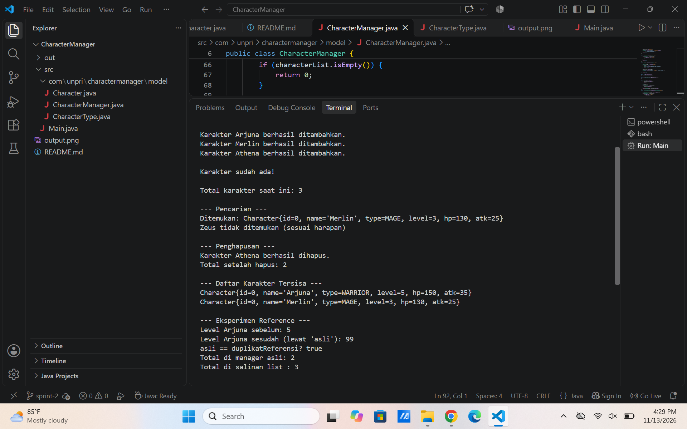
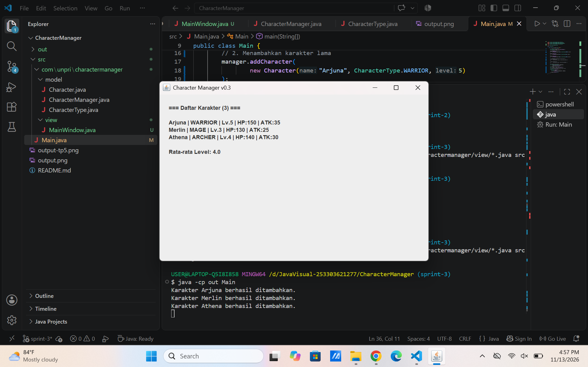
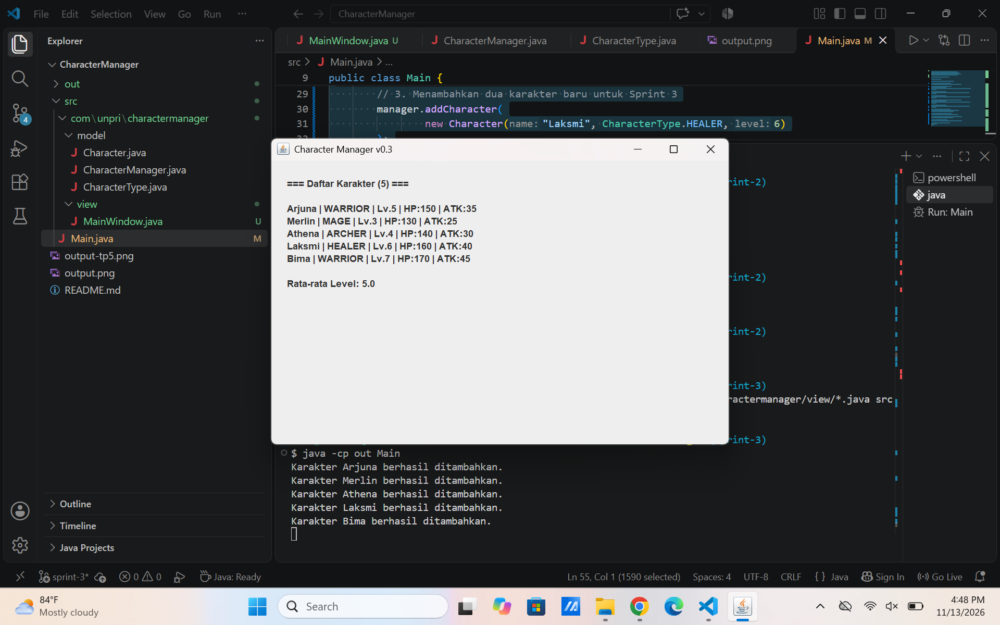
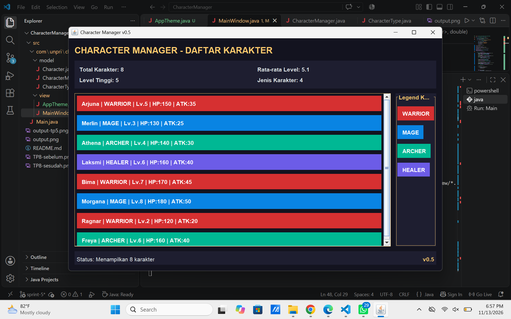

## Character Manager — TP3 (Java Visual SIH-6406)
Deskripsi

Character Manager merupakan aplikasi sederhana berbasis Java yang dibuat untuk memenuhi tugas TP3 mata kuliah Java Visual SIH-6406.

Project ini menerapkan konsep Object-Oriented Programming (OOP), khususnya Encapsulation, Constructor Overloading, dan Enum. Aplikasi dapat membuat karakter, menampilkan atribut karakter, melakukan level up, mengatur mana, serta memeriksa status kehidupan karakter menggunakan method isAlive().

## Struktur Folder Project

```text
CharacterManager/
├── src/
│   ├── Main.java
│   └── com/
│       └── unpri/
│           └── charactermanager/
│               └── model/
│                   ├── Character.java
│                   └── CharacterType.java
├── README.md
└── output.png
```
## Screenshot Output Program

Berikut merupakan hasil eksekusi program Character Manager melalui Visual Studio Code.


## Output program mencakup:

Pembuatan tiga karakter (Arjuna, Merlin, dan Athena).
Demonstrasi kenaikan level karakter Arjuna.
Perhitungan ulang HP dan attack setelah level up.
Pembuatan karakter Raven dengan mana sebesar 200.
Pengujian method isAlive() yang menghasilkan nilai true.
Fitur Program
Membuat karakter menggunakan constructor.
Menggunakan enum untuk menentukan jenis karakter.
Menerapkan Encapsulation melalui atribut private.
Menggunakan getter dan setter untuk mengakses atribut.
Menghitung ulang HP dan attack ketika level berubah.
Mengatur mana dengan validasi agar tidak bernilai negatif.
Memeriksa status kehidupan karakter melalui method isAlive().
Menampilkan informasi karakter menggunakan toString().

## Identitas Mahasiswa
Nama Lengkap: Tisa Kiranta Br Tarigan
NIM: 253303621277
Mata Kuliah: Java Visual SIH-6406
Google Docs Analisis Desain: https://docs.google.com/document/d/1H1kSqVmylhUJ7km8Ja1zqyYtVCurgs787BVLEGl63nM/edit?usp=sharing


### TP5 — Character Manager: ArrayList & Object Reference ###
Fitur yang Diimplementasikan

Pada TP5, project Character Manager dikembangkan dengan menggunakan ArrayList untuk mengelola banyak object Character secara dinamis.

## Fitur yang ditambahkan:

Override equals() untuk membandingkan karakter berdasarkan nama.
addCharacter() untuk menambahkan karakter dan mencegah nama duplikat.
findByName() untuk mencari karakter.
removeCharacter() untuk menghapus karakter berdasarkan nama.
getTotalCharacters() untuk menghitung jumlah karakter.
getAllCharacters() untuk mengembalikan defensive copy.
getAverageLevel() untuk menghitung rata-rata level karakter.
findByType() untuk mencari karakter berdasarkan jenisnya.
countByType() sebagai fitur analitik tambahan untuk menghitung jumlah karakter berdasarkan tipe.
Fitur Mandiri: countByType()

Saya menambahkan method countByType(CharacterType type) untuk menghitung jumlah karakter berdasarkan tipe tertentu. Fitur ini berguna untuk mengetahui komposisi karakter dalam aplikasi, misalnya jumlah WARRIOR, MAGE, ARCHER, dan HEALER.

Method ini menjaga encapsulation karena hanya mengembalikan nilai integer dan tidak memberikan akses langsung ke ArrayList internal.


## Screenshot Output TP5



### Hasil Eksperimen Object Reference

Eksperimen membuktikan bahwa dua variabel dapat menunjuk ke object
Character yang sama. Perubahan level melalui salah satu reference
akan terlihat melalui reference lainnya.

Sementara itu, getAllCharacters() mengembalikan salinan ArrayList,
sehingga perubahan struktur pada list salinan tidak memengaruhi
list asli dalam CharacterManager.

## Dokumen analisis reference dan rancangan:

https://docs.google.com/document/d/1d1Vn8ArelyxVKwGujmrTHSKaJhGMk7xp4i-FObSx1ro/edit?usp=sharing


### TP8 - Character Manager Sprint #3

Implementasi MainWindow

Pada TP8, aplikasi Character Manager dikembangkan dari aplikasi berbasis console menjadi aplikasi GUI menggunakan Java Swing. Kelas MainWindow dibuat dengan mewarisi JFrame. Data karakter ditampilkan secara dinamis menggunakan perulangan for-each dan komponen JLabel.

## Screenshot




## Aliran Data dan MVC

Main.java bertugas membuat objek CharacterManager dan menambahkan data karakter ke dalam sistem. CharacterManager berperan sebagai bagian dari Model yang mengelola data karakter dan menyediakan daftar karakter beserta rata-rata levelnya. Data tersebut kemudian dikirimkan oleh Main.java ke MainWindow sebagai View untuk ditampilkan menggunakan JLabel. Dengan demikian, Model bertanggung jawab terhadap pengelolaan data, sedangkan View bertanggung jawab terhadap tampilan aplikasi.

## Karakter Baru

Laksmi - HEALER, Level 6
Ditambahkan sebagai karakter pendukung untuk menambah variasi tipe karakter.

Bima - WARRIOR, Level 7
Ditambahkan sebagai karakter petarung dengan level lebih tinggi.

## Dokumen Google Docs:
https://docs.google.com/document/d/1v2Zi0yl9s2j8avFf8x0IP74jFcj4JJM9QB9TH5dbBmo/edit?usp=sharing


# # Character Manager – Sprint #5

**TP12 · AP16 – Layout, UI Responsif & Analisis MVC**

## Deskripsi Proyek

Character Manager adalah aplikasi desktop sederhana berbasis Java Swing yang digunakan untuk mengelola dan menampilkan data karakter. Aplikasi ini dikembangkan dengan menerapkan konsep Object-Oriented Programming (OOP), Model-View-Controller (MVC), serta Layout Manager pada Java Swing.

Pada Sprint #5, pengembangan difokuskan pada penyusunan tampilan yang lebih rapi, penggunaan layout yang responsif, penambahan panel statistik, legenda tipe karakter, dan status bar.

## Implementasi Layout

Aplikasi menggunakan `BorderLayout` sebagai layout utama yang membagi tampilan menjadi empat bagian:

| Posisi | Komponen | Fungsi |
|---|---|---|
| NORTH | Header dan panel statistik | Menampilkan judul aplikasi dan informasi karakter |
| CENTER | JScrollPane dan daftar karakter | Menampilkan daftar karakter yang dapat digulir |
| EAST | Panel legenda | Menampilkan warna berdasarkan tipe karakter |
| SOUTH | Status bar | Menampilkan informasi aplikasi dan versi |

### Header dan Panel Statistik

Bagian header menampilkan judul aplikasi Character Manager. Di bawahnya terdapat panel statistik yang menggunakan `GridLayout` dengan susunan 2 baris dan 2 kolom.

Informasi yang ditampilkan meliputi:
- Jumlah karakter.
- Rata-rata level karakter.
- Jumlah karakter dengan level tinggi.
- Jumlah tipe karakter.

### Status Bar

Status bar ditempatkan di bagian SOUTH menggunakan `BorderLayout`.

- Bagian kiri menampilkan informasi jumlah karakter.
- Bagian kanan menampilkan versi aplikasi, yaitu `v0.5`.

##  Tema dan Warna Aplikasi

Untuk membuat tampilan lebih menarik dan konsisten, aplikasi menggunakan kelas `AppTheme.java` sebagai tempat penyimpanan warna dan font.

Tema yang digunakan adalah dark navy dengan beberapa warna pembeda:

| Tipe Karakter | Warna |
|---|---|
| WARRIOR | Merah |
| MAGE | Biru |
| ARCHER | Hijau |
| HEALER | Ungu |

Penggunaan kelas `AppTheme` membuat pengaturan tampilan lebih terpusat. Jika warna atau font ingin diubah, pengaturan dapat dilakukan melalui satu kelas tanpa harus mengubah banyak bagian pada `MainWindow`.

## Data Karakter

Aplikasi menampilkan 8 karakter dengan tipe dan level yang berbeda.

| No. | Nama | Tipe | Level |
|---|---|---|---:|
| 1 | Arjuna | WARRIOR | 5 |
| 2 | Merlin | MAGE | 3 |
| 3 | Athena | ARCHER | 4 |
| 4 | Laksmi | HEALER | 6 |
| 5 | Bima | WARRIOR | 7 |
| 6 | Morgana | MAGE | 8 |
| 7 | Ragnar | WARRIOR | 2 |
| 8 | Freya | ARCHER | 6 |

## 7. Pengujian Tampilan Responsif

Pengujian dilakukan dengan mengubah ukuran jendela aplikasi untuk mengetahui bagaimana setiap komponen menyesuaikan diri.

### Screenshot 1 – Tampilan Awal



Keterangan: Tampilan aplikasi pada ukuran jendela normal. Header, statistik, daftar karakter, legenda, dan status bar terlihat.

### Screenshot 2 – Tampilan Diperlebar


Keterangan: Jendela aplikasi diperlebar untuk mengamati perubahan ukuran dan posisi komponen. Ruang daftar karakter menjadi lebih luas.

### Screenshot 3 – Tampilan Diperkecil


Keterangan: Jendela aplikasi diperkecil untuk menguji kemampuan layout dalam menyesuaikan ruang. Scrollbar digunakan untuk melihat daftar karakter ketika ruang tampilan tidak mencukupi.

### Tabel Pengamatan Resize

| Pengujian | Prediksi | Hasil Pengamatan |
|---|---|---|
| Ukuran normal | Semua komponen terlihat | Komponen tampil sesuai pembagian layout |
| Jendela diperlebar | Area daftar karakter menjadi lebih luas | Daftar karakter memperoleh ruang lebih besar |
| Jendela diperkecil | Ruang daftar karakter berkurang dan scrollbar muncul jika diperlukan | Scrollbar membantu melihat daftar karakter |

## 8. Alasan Pemilihan Layout Manager

### BorderLayout

`BorderLayout` dipilih sebagai layout utama karena dapat membagi jendela menjadi lima area, yaitu NORTH, SOUTH, EAST, WEST, dan CENTER. Pembagian ini memudahkan penempatan header, daftar karakter, legenda, dan status bar.

### GridLayout

`GridLayout` digunakan pada panel statistik karena dapat menyusun komponen dalam baris dan kolom dengan ukuran sel yang sama. Layout ini membuat informasi statistik terlihat teratur.

GridLayout juga digunakan pada panel daftar karakter agar setiap kartu karakter tersusun dalam satu kolom.

### BoxLayout

`BoxLayout.Y_AXIS` dipilih untuk panel legenda karena komponen perlu disusun secara vertikal. Layout ini memudahkan penambahan tipe karakter baru secara berurutan.

### Layout yang Tidak Dipilih

`FlowLayout` tidak dipilih sebagai layout utama karena penyusunan komponen mengikuti aliran kiri ke kanan dan dapat berpindah baris ketika ruang tidak mencukupi. Hal tersebut kurang sesuai untuk pembagian area aplikasi yang sudah ditentukan.

`GridLayout` juga tidak dipilih sebagai layout utama karena seluruh area akan dibagi menjadi sel yang sama, padahal header, daftar karakter, legenda, dan status bar memiliki kebutuhan ruang yang berbeda.

##  Analisis Struktur Panel

Struktur tampilan dibuat secara bertingkat atau nested panel. Panel utama menggunakan `BorderLayout` sebagai wadah seluruh komponen. Di bagian NORTH terdapat panel header dan panel statistik. Bagian CENTER berisi panel pembungkus daftar karakter yang dimasukkan ke dalam `JScrollPane`. Bagian EAST berisi panel legenda, sedangkan bagian SOUTH berisi status bar.

Struktur bertingkat ini membuat setiap bagian memiliki tanggung jawab tampilan masing-masing. Dengan demikian, pengaturan satu panel tidak harus mengubah seluruh komponen aplikasi.

##  Analisis MVC

Proyek ini menerapkan pemisahan antara bagian model dan view.

**Model** terdiri dari:
- `Character.java`: menyimpan data karakter.
- `CharacterManager.java`: mengelola kumpulan karakter.
- `CharacterType.java`: mendefinisikan tipe karakter menggunakan enum.

**View** terdiri dari:
- `MainWindow.java`: mengatur tampilan utama aplikasi.
- `AppTheme.java`: mengatur warna, font, dan tema aplikasi.

**Main.java** berfungsi sebagai titik awal aplikasi, membuat data karakter, dan menjalankan tampilan menggunakan `SwingUtilities.invokeLater()`.

Pemisahan ini membuat kode lebih mudah dipelihara. Contohnya, jika daftar karakter ingin diubah dari kumpulan `JPanel` menjadi `JTable`, perubahan dapat difokuskan pada bagian view tanpa harus mengubah cara model menyimpan data karakter.

##  Dokumentasi Google Docs

Link Google Docs Analisis TP12:https://docs.google.com/document/d/1UBbkj-cEvfovZtb-TRMIS8zx4XC6FR_dXmFMy96oK2o/edit?usp=sharing


