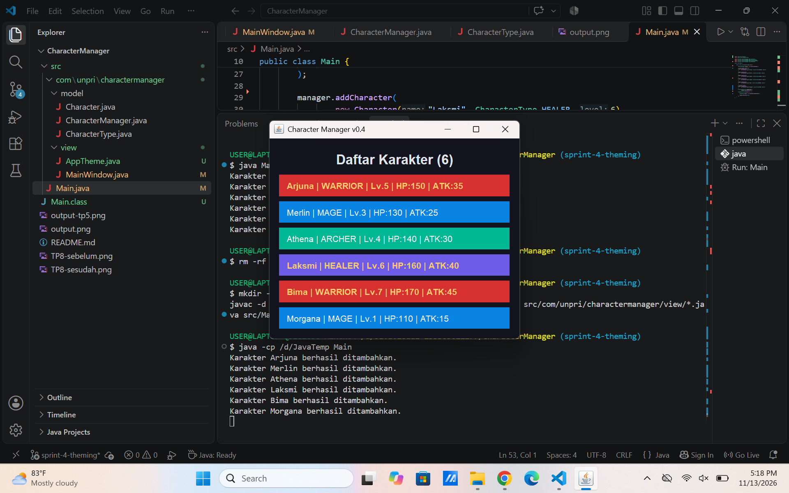

## Character Manager — TP3 (Java Visual SIH-6406)
Deskripsi

Character Manager merupakan aplikasi sederhana berbasis Java yang dibuat untuk memenuhi tugas TP3 mata kuliah Java Visual SIH-6406.

Project ini menerapkan konsep Object-Oriented Programming (OOP), khususnya Encapsulation, Constructor Overloading, dan Enum. Aplikasi dapat membuat karakter, menampilkan atribut karakter, melakukan level up, mengatur mana, serta memeriksa status kehidupan karakter menggunakan method isAlive().

## Struktur Folder Project

```text
CharacterManager/
├── src/
│   ├── Main.java
│   └── com/
│       └── unpri/
│           └── charactermanager/
│               └── model/
│                   ├── Character.java
│                   └── CharacterType.java
├── README.md
└── output.png
```
## Screenshot Output Program

Berikut merupakan hasil eksekusi program Character Manager melalui Visual Studio Code.


## Output program mencakup:

Pembuatan tiga karakter (Arjuna, Merlin, dan Athena).
Demonstrasi kenaikan level karakter Arjuna.
Perhitungan ulang HP dan attack setelah level up.
Pembuatan karakter Raven dengan mana sebesar 200.
Pengujian method isAlive() yang menghasilkan nilai true.
Fitur Program
Membuat karakter menggunakan constructor.
Menggunakan enum untuk menentukan jenis karakter.
Menerapkan Encapsulation melalui atribut private.
Menggunakan getter dan setter untuk mengakses atribut.
Menghitung ulang HP dan attack ketika level berubah.
Mengatur mana dengan validasi agar tidak bernilai negatif.
Memeriksa status kehidupan karakter melalui method isAlive().
Menampilkan informasi karakter menggunakan toString().

## Identitas Mahasiswa
Nama Lengkap: Tisa Kiranta Br Tarigan
NIM: 253303621277
Mata Kuliah: Java Visual SIH-6406
Google Docs Analisis Desain: https://docs.google.com/document/d/1H1kSqVmylhUJ7km8Ja1zqyYtVCurgs787BVLEGl63nM/edit?usp=sharing


### TP5 — Character Manager: ArrayList & Object Reference ###
Fitur yang Diimplementasikan

Pada TP5, project Character Manager dikembangkan dengan menggunakan ArrayList untuk mengelola banyak object Character secara dinamis.

## Fitur yang ditambahkan:

Override equals() untuk membandingkan karakter berdasarkan nama.
addCharacter() untuk menambahkan karakter dan mencegah nama duplikat.
findByName() untuk mencari karakter.
removeCharacter() untuk menghapus karakter berdasarkan nama.
getTotalCharacters() untuk menghitung jumlah karakter.
getAllCharacters() untuk mengembalikan defensive copy.
getAverageLevel() untuk menghitung rata-rata level karakter.
findByType() untuk mencari karakter berdasarkan jenisnya.
countByType() sebagai fitur analitik tambahan untuk menghitung jumlah karakter berdasarkan tipe.
Fitur Mandiri: countByType()

Saya menambahkan method countByType(CharacterType type) untuk menghitung jumlah karakter berdasarkan tipe tertentu. Fitur ini berguna untuk mengetahui komposisi karakter dalam aplikasi, misalnya jumlah WARRIOR, MAGE, ARCHER, dan HEALER.

Method ini menjaga encapsulation karena hanya mengembalikan nilai integer dan tidak memberikan akses langsung ke ArrayList internal.


## Screenshot Output TP5


### Hasil Eksperimen Object Reference

Eksperimen membuktikan bahwa dua variabel dapat menunjuk ke object
Character yang sama. Perubahan level melalui salah satu reference
akan terlihat melalui reference lainnya.

Sementara itu, getAllCharacters() mengembalikan salinan ArrayList,
sehingga perubahan struktur pada list salinan tidak memengaruhi
list asli dalam CharacterManager.

## Dokumen analisis reference dan rancangan:

https://docs.google.com/document/d/1d1Vn8ArelyxVKwGujmrTHSKaJhGMk7xp4i-FObSx1ro/edit?usp=sharing


### TP8 - Character Manager Sprint #3

Implementasi MainWindow

Pada TP8, aplikasi Character Manager dikembangkan dari aplikasi berbasis console menjadi aplikasi GUI menggunakan Java Swing. Kelas MainWindow dibuat dengan mewarisi JFrame. Data karakter ditampilkan secara dinamis menggunakan perulangan for-each dan komponen JLabel.

## Screenshot


## Aliran Data dan MVC

Main.java bertugas membuat objek CharacterManager dan menambahkan data karakter ke dalam sistem. CharacterManager berperan sebagai bagian dari Model yang mengelola data karakter dan menyediakan daftar karakter beserta rata-rata levelnya. Data tersebut kemudian dikirimkan oleh Main.java ke MainWindow sebagai View untuk ditampilkan menggunakan JLabel. Dengan demikian, Model bertanggung jawab terhadap pengelolaan data, sedangkan View bertanggung jawab terhadap tampilan aplikasi.

## Karakter Baru

Laksmi - HEALER, Level 6
Ditambahkan sebagai karakter pendukung untuk menambah variasi tipe karakter.

Bima - WARRIOR, Level 7
Ditambahkan sebagai karakter petarung dengan level lebih tinggi.

## Dokumen Google Docs:
https://docs.google.com/document/d/1v2Zi0yl9s2j8avFf8x0IP74jFcj4JJM9QB9TH5dbBmo/edit?usp=sharing


## TP10 – Character Manager Sprint #4

### Screenshot
#### Sebelum (v0.3)


#### Sesudah (v0.4)


### Pemisahan Tema dan Model
Warna disimpan dalam AppTheme karena warna merupakan bagian dari tampilan aplikasi, bukan data karakter. Class Character hanya bertanggung jawab menyimpan informasi karakter seperti nama, role, level, HP, dan ATK. Dengan pemisahan ini, perubahan warna atau desain aplikasi dapat dilakukan tanpa mengubah class Character. Hal ini membuat program lebih mudah dirawat dan mengikuti konsep pemisahan tanggung jawab dalam MVC.

### Properti Tambahan
1. Tooltip: menampilkan informasi role, HP, dan ATK ketika pointer diarahkan ke kartu karakter.
2. Cursor: mengubah pointer menjadi bentuk tangan ketika diarahkan ke kartu sehingga memberikan petunjuk visual kepada pengguna.

### Mini-Challenge
Karakter dengan level minimal 5 ditampilkan menggunakan tulisan berwarna emas dan tebal. Batas level disimpan dalam konstanta HIGH_LEVEL_THRESHOLD di AppTheme.

### Dokumen Analisis TP10

Link Google Docs:
https://docs.google.com/document/d/1UBbkj-cEvfovZtb-TRMIS8zx4XC6FR_dXmFMy96oK2o/edit?usp=sharing
