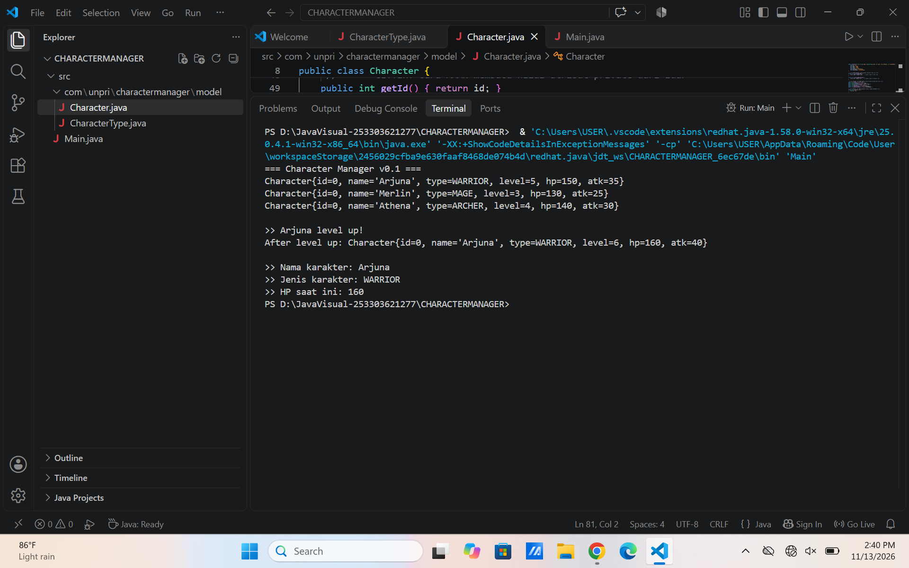

## Character Manager — TP3 (Java Visual SIH-6406)
Deskripsi

Character Manager merupakan aplikasi sederhana berbasis Java yang dibuat untuk memenuhi tugas TP3 mata kuliah Java Visual SIH-6406.

Project ini menerapkan konsep Object-Oriented Programming (OOP), khususnya Encapsulation, Constructor Overloading, dan Enum. Aplikasi dapat membuat karakter, menampilkan atribut karakter, melakukan level up, mengatur mana, serta memeriksa status kehidupan karakter menggunakan method isAlive().

## Struktur Folder Project

```text
CharacterManager/
├── src/
│   ├── Main.java
│   └── com/
│       └── unpri/
│           └── charactermanager/
│               └── model/
│                   ├── Character.java
│                   └── CharacterType.java
├── README.md
└── output.png
```
## Screenshot Output Program

Berikut merupakan hasil eksekusi program Character Manager melalui Visual Studio Code.


## Output program mencakup:

Pembuatan tiga karakter (Arjuna, Merlin, dan Athena).
Demonstrasi kenaikan level karakter Arjuna.
Perhitungan ulang HP dan attack setelah level up.
Pembuatan karakter Raven dengan mana sebesar 200.
Pengujian method isAlive() yang menghasilkan nilai true.
Fitur Program
Membuat karakter menggunakan constructor.
Menggunakan enum untuk menentukan jenis karakter.
Menerapkan Encapsulation melalui atribut private.
Menggunakan getter dan setter untuk mengakses atribut.
Menghitung ulang HP dan attack ketika level berubah.
Mengatur mana dengan validasi agar tidak bernilai negatif.
Memeriksa status kehidupan karakter melalui method isAlive().
Menampilkan informasi karakter menggunakan toString().

## Identitas Mahasiswa
Nama Lengkap: Tisa Kiranta Br Tarigan
NIM: 253303621277
Mata Kuliah: Java Visual SIH-6406
Google Docs Analisis Desain: https://docs.google.com/document/d/1H1kSqVmylhUJ7km8Ja1zqyYtVCurgs787BVLEGl63nM/edit?usp=sharing
